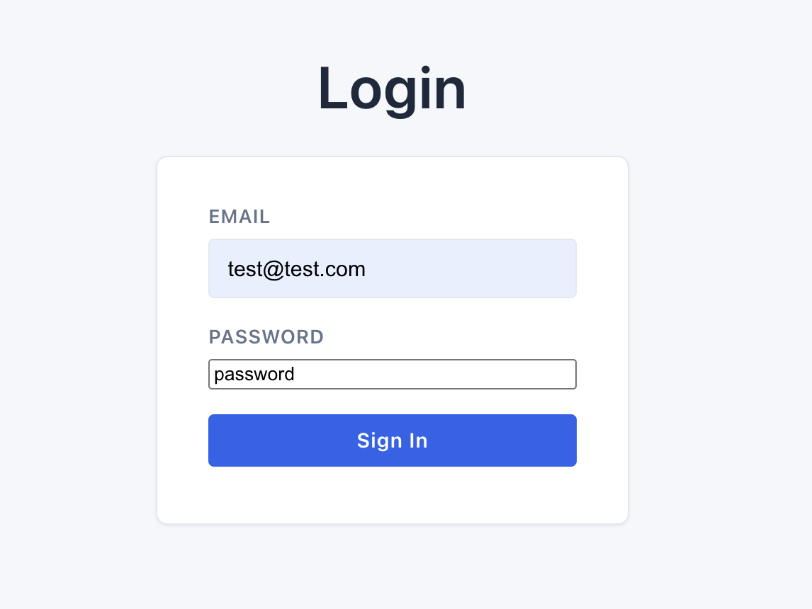
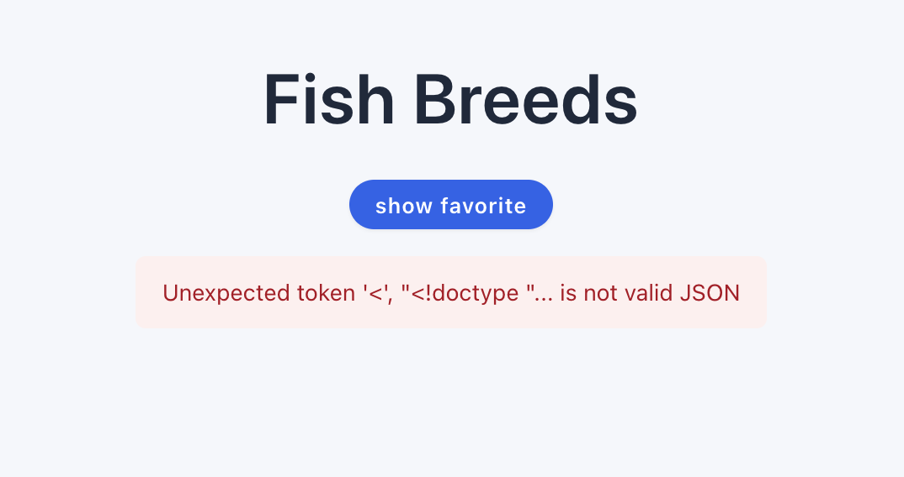
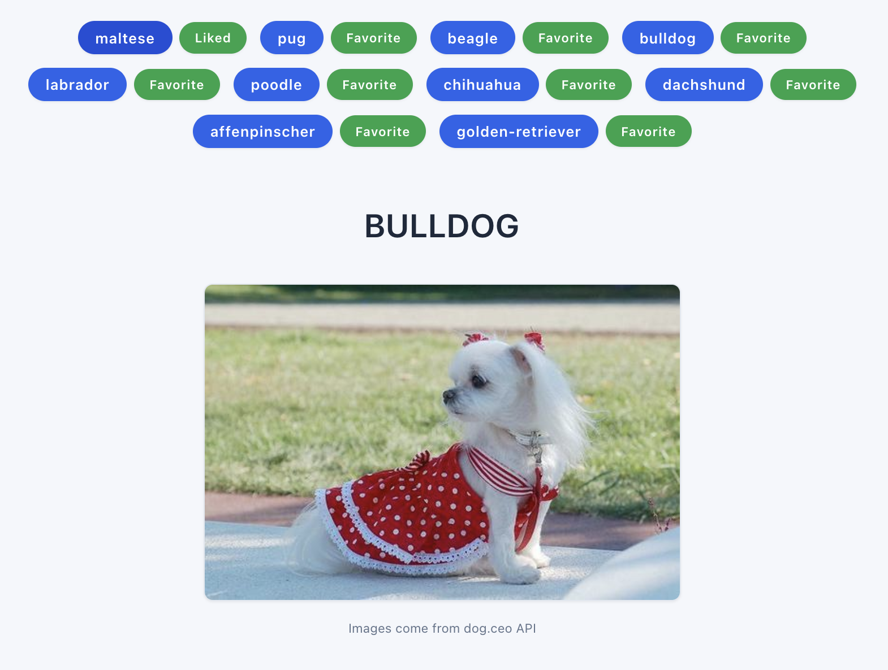
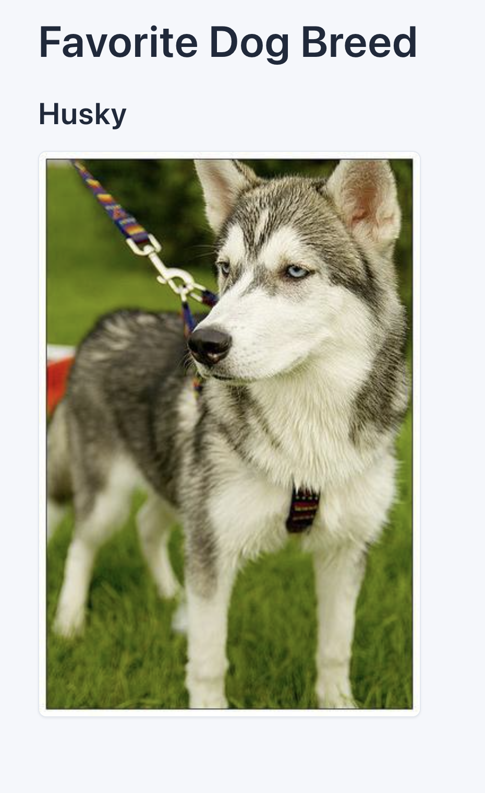

# QA Report: Dog Breeds App

| | |
|---|---|
| **Tester** | Anthony Clement |
| **Date** | 2026-10-15 |
| **Build under test** | `main` @ `c91d7cd` (Init Assignment Repo) |
| **Report status** | Final |

---

## Contents

1. [Summary](#1-summary)
2. [Test Environment](#2-test-environment)
3. [Scope & Approach](#3-scope--approach)
4. [Findings](#4-findings)
   - [4.1 Login](#41-login)
   - [4.2 Breeds (Catalog & Likes)](#42-breeds-catalog--likes)
   - [4.3 Favorite](#43-favorite)
   - [4.4 Global / Cross-cutting](#44-global--cross-cutting)
5. [General Observations](#5-general-observations)
6. [Tools & Scripts Used](#6-tools--scripts-used)
7. [Collaboration Log](#7-collaboration-log)

---

## 1. Summary

Testing found **26 issues**: 1 Blocker, 2 Critical, 5 Major, 14 Minor and 4 Trivial.

As shipped, three of the app's four core features don't work as specified:

- **Catalog:** the breed list doesn't load at all ([BUG-003](#bug-003-breeds-list-never-loads-because-the-app-requests-a-misspelled-json-file)). Once that is fixed, the heading above each photo names a random breed ([BUG-006](#bug-006-image-heading-shows-a-random-breed-name-instead-of-the-breed-that-was-clicked)), and 2 of the 10 breeds never load a photo ([BUG-011](#bug-011-two-of-the-ten-breeds-never-load-an-image)).
- **Favorite:** a single favorite can't be chosen ([BUG-005](#bug-005-multiple-breeds-can-be-marked-favorite-and-no-single-favorite-can-be-set)), and the Favorite page always shows a husky ([BUG-007](#bug-007-favorite-page-always-shows-husky-whatever-the-user-picked)).
- **Likes:** they work within a single visit but are lost on refresh or navigation ([BUG-010](#bug-010-likes-are-lost-on-page-refresh-or-navigation)).

Login works with the provided accounts, but it shows the password in plain text ([BUG-001](#bug-001-password-is-displayed-in-plain-text)), doesn't validate input ([BUG-009](#bug-009-login-validation-is-missing-and-valid-emails-with-capitals-or-spaces-are-rejected)), and doesn't protect the other pages ([BUG-019](#bug-019-breeds-and-favorite-pages-open-without-logging-in-and-there-is-no-logout)).

The remaining findings fall into three themes: error handling (raw messages, no retry, race conditions), accessibility (contrast, screen-reader labels and announcements), and visual consistency.

### Recommended Fix Order

1. **BUG-003**, so the catalog loads.
2. **One-line fixes** with high visibility: BUG-001, BUG-004, BUG-006.
3. **Likes and favorite on shared, persisted state:** BUG-005, BUG-007, BUG-010. A single design decision fixes all three.
4. **Catalog data:** BUG-011, BUG-017.
5. **Sign-in flow and error handling:** BUG-019, BUG-020, BUG-012, BUG-009.
6. **Accessibility**, then **visual polish**.

### Findings at a Glance

Sorted by severity, then priority.

| ID | Title | Page | Severity | Priority |
|---|---|---|---|---|
| [BUG-003](#bug-003-breeds-list-never-loads-because-the-app-requests-a-misspelled-json-file) | Breeds list never loads because the app requests a misspelled JSON file | Breeds | Blocker | P1 |
| [BUG-005](#bug-005-multiple-breeds-can-be-marked-favorite-and-no-single-favorite-can-be-set) | Multiple breeds can be marked "Favorite" and no single favorite can be set | Breeds | Critical | P1 |
| [BUG-007](#bug-007-favorite-page-always-shows-husky-whatever-the-user-picked) | Favorite page always shows Husky, whatever the user picked | Favorite | Critical | P1 |
| [BUG-001](#bug-001-password-is-displayed-in-plain-text) | Password is displayed in plain text | Login | Major | P1 |
| [BUG-006](#bug-006-image-heading-shows-a-random-breed-name-instead-of-the-breed-that-was-clicked) | Image heading shows a random breed name instead of the breed that was clicked | Breeds | Major | P1 |
| [BUG-010](#bug-010-likes-are-lost-on-page-refresh-or-navigation) | Likes are lost on page refresh or navigation | Breeds | Major | P1 |
| [BUG-011](#bug-011-two-of-the-ten-breeds-never-load-an-image) | Two of the ten breeds never load an image | Breeds | Major | P1 |
| [BUG-019](#bug-019-breeds-and-favorite-pages-open-without-logging-in-and-there-is-no-logout) | Breeds and Favorite pages open without logging in, and there is no logout | Global | Major | P2 |
| [BUG-004](#bug-004-breeds-page-heading-says-fish-breeds-instead-of-dog-breeds) | Breeds page heading says "Fish Breeds" instead of "Dog Breeds" | Breeds | Minor | P1 |
| [BUG-008](#bug-008-favorite-page-shows-one-image-then-swaps-it-for-a-different-one) | Favorite page shows one image, then swaps it for a different one | Favorite | Minor | P2 |
| [BUG-009](#bug-009-login-validation-is-missing-and-valid-emails-with-capitals-or-spaces-are-rejected) | Login validation is missing and valid emails with capitals or spaces are rejected | Login | Minor | P2 |
| [BUG-012](#bug-012-clicking-breeds-quickly-can-show-a-photo-of-the-wrong-breed) | Clicking breeds quickly can show a photo of the wrong breed | Breeds | Minor | P2 |
| [BUG-013](#bug-013-like-buttons-and-the-image-credit-fail-colour-contrast-requirements) | Like buttons and the image credit fail colour contrast requirements | Breeds | Minor | P2 |
| [BUG-014](#bug-014-like-and-show-favorite-buttons-are-confusing-for-screen-reader-and-keyboard-users) | Like and Show favorite buttons are confusing for screen-reader and keyboard users | Breeds | Minor | P2 |
| [BUG-018](#bug-018-favorite-page-has-no-way-back-to-breeds-and-is-not-centred) | Favorite page has no way back to Breeds and is not centred | Favorite | Minor | P2 |
| [BUG-020](#bug-020-error-messages-are-technical-or-vague-and-offer-no-retry) | Error messages are technical or vague and offer no retry | Global | Minor | P2 |
| [BUG-002](#bug-002-login-form-is-pinned-to-the-top-of-the-page-under-an-oversized-generic-heading) | Login form is pinned to the top of the page under an oversized, generic heading | Login | Minor | P3 |
| [BUG-015](#bug-015-liked-state-is-hard-to-see-and-hovering-turns-the-button-dark-red) | Liked state is hard to see, and hovering turns the button dark red | Breeds | Minor | P3 |
| [BUG-021](#bug-021-loading-and-error-states-are-not-announced-to-screen-readers) | Loading and error states are not announced to screen readers | Global | Minor | P3 |
| [BUG-022](#bug-022-image-area-jumps-in-height-while-images-load) | Image area jumps in height while images load | Global | Minor | P3 |
| [BUG-023](#bug-023-unknown-urls-show-a-blank-page) | Unknown URLs show a blank page | Global | Minor | P3 |
| [BUG-024](#bug-024-readme-instructions-do-not-match-the-app) | README instructions do not match the app | Global | Minor | P3 |
| [BUG-016](#bug-016-show-favorite-button-looks-like-a-breed-and-is-shown-in-lowercase) | Show favorite button looks like a breed and is shown in lowercase | Breeds | Trivial | P3 |
| [BUG-017](#bug-017-breed-data-is-inconsistent-and-names-are-shown-as-raw-ids) | Breed data is inconsistent and names are shown as raw IDs | Breeds | Trivial | P3 |
| [BUG-025](#bug-025-browser-tab-shows-the-project-name-and-the-vite-logo-on-every-page) | Browser tab shows the project name and the Vite logo on every page | Global | Trivial | P3 |
| [BUG-026](#bug-026-every-page-scrolls-slightly-even-when-its-content-fits) | Every page scrolls slightly even when its content fits | Global | Trivial | P3 |

### Count by Severity

| Blocker | Critical | Major | Minor | Trivial | **Total** |
|---|---|---|---|---|---|
| 1 | 2 | 5 | 14 | 4 | **26** |

---

## 2. Test Environment

| Item | Value |
|---|---|
| OS | macOS 27.0.1 (build 26A434) |
| Browser + version | Dia 1.52.0 (88431), Chromium engine 155.0.8059.40 |
| Node / npm | v24.19.0 / 11.17.0 |
| Key dependencies | React 19.2.0, React Router 7.9.4, Vite 7.1.11 |
| Run mode | `npm run dev` (Vite dev server, `http://localhost:5173`) |
| Test accounts | `test@test.com` / `password`, `qa@demo.com` / `demo123` (from `public/users.json`) |
| External services | dog.ceo public API (`https://dog.ceo/api/breed/{breed}/images/random`) |

---

## 3. Scope & Approach

**In scope:** login, breed catalog, likes and favorite, tested for functionality, UX, accessibility, performance and displayed data.

**Out of scope:** security and production hardening. The README states that auth is mock-only by design.

**Approach:**

- Exploratory testing of each page in the UI, including happy paths, edge cases, error states and direct URL navigation
- Network inspection of fixture and dog.ceo API requests in DevTools
- Static review of the source to find root causes and suggest fixes
- `npm run lint` output
- Accessibility checks: keyboard-only navigation, screen-reader semantics, colour contrast

### Severity Rubric (from README)

| Severity | Definition |
|---|---|
| **Blocker** | Prevents testing or core flows (e.g. cannot log in). |
| **Critical** | Core feature broken with no reasonable workaround (e.g. cannot set a favorite). |
| **Major** | Significant defect with a workaround; meaningfully harms UX. |
| **Minor** | Smaller UX/a11y/copy problems; still worth fixing. |
| **Trivial** | Cosmetic nits or very low impact. |

### Priority

Severity describes impact. Priority describes how soon a defect should be fixed.

| Priority | Meaning |
|---|---|
| **P1** | Fix before release; blocks core functionality or is trivial to fix and highly visible. |
| **P2** | Fix soon; noticeable harm to UX or correctness. |
| **P3** | Fix when convenient; polish. |

---

## 4. Findings

Screenshots and clips are stored in [`evidence/`](evidence/). Some screenshots show more than one finding, so they are named by screen (e.g. `evidence/login.png`).

File and line references point to the build under test (commit `c91d7cd`). Findings after BUG-003 were tested with the `breeds.json` path fixed locally, as the README instructs.

### 4.1 Login

### BUG-001: Password is displayed in plain text

| Severity | Priority | Component | Category |
|---|---|---|---|
| Major | P1 | `src/components/Login.jsx` | UX / Privacy |

**Summary**

The Password field is a plain text input, so the password is readable on screen as it is typed. The field also misses the form styling applied to the Email field, so the two inputs look different.

**Location / Reference**

`src/components/Login.jsx:44-53`

```jsx
<input
  id="password"
  type="text"
  autoComplete="current-password"
  ...
/>
```

`src/index.css:56`: the input styles only target `email` and `password` types.

```css
input[type="email"], input[type="password"] { ... }
```

**Steps to Reproduce**

1. Run `npm run dev` and open `http://localhost:5173/`.
2. Click the **Password** field and type any value (e.g. `password`).

**Expected Result**

- Typed characters are masked (e.g. `••••••••`).
- The Password field has the same padding, border and height as the Email field.

**Actual Result**

- The password is shown in plain text.
- The Password field uses the browser's default input styling (no padding, different border and height), so it doesn't match the Email field above it.

**Evidence**



_The password reads "password" in plain text, and its field uses the browser's default styling, unlike the Email field above it._

**Impact / Risk**

- Anyone who can see the screen can read the password, including people nearby and viewers of a screen share or recording.
- It breaks a near-universal user expectation and undermines trust in the app.
- The mismatched field styling makes the form look unfinished.
- Password managers may not reliably recognise a text input as a password field.

**Root Cause (Hypothesized)**

The input is declared as `type="text"` instead of `type="password"`. As a side effect, it doesn't match the `input[type="password"]` CSS selector, which is why the styling differs.

**Suggested Fix**

Change the input type. This fixes both the masking and the styling:

```jsx
<input id="password" type="password" autoComplete="current-password" ... />
```

Optionally, add an accessible "Show password" toggle so users can still check what they typed (a `<button type="button">` with `aria-pressed` and `aria-controls="password"`).

---

### BUG-002: Login form is pinned to the top of the page under an oversized, generic heading

| Severity | Priority | Component | Category |
|---|---|---|---|
| Minor | P3 | `src/components/Login.jsx`, `src/index.css` | UX / Visual Design / Copy |

**Summary**

The login page sits at the very top of the viewport and leaves most of the screen empty below. A large "Login" heading above the card dominates the page and doesn't name the app. The heading also says "Login" while the button says "Sign In".

**Location / Reference**

`src/index.css:22-31`: page content is aligned to the top.

```css
body { display: flex; justify-content: center; align-items: flex-start; padding: 2rem 1rem 4rem; ... }
```

`src/index.css:34`: the `h1` grows up to 2.6rem (41.6px).

```css
h1 { margin: 0 0 1.25rem; font-size: clamp(1.9rem, 4vw, 2.6rem); }
```

`src/components/Login.jsx:28`: the heading sits outside the card.

```jsx
<h1>Login</h1>
<div className="card" ...>
```

**Steps to Reproduce**

1. Open `http://localhost:5173/` at a desktop viewport (e.g. 1440×900).
2. Look at where the heading and login card sit on the page.

**Expected Result**

- The login card is the visual focus and is centred both horizontally and vertically.
- The heading is in proportion to the card and tells the user which app they are signing into (e.g. "Sign in to Dog Breeds").
- The heading and the button use the same wording.

**Actual Result**

- The heading and card are pinned to the top of the viewport, with most of the screen empty below.
- "Login" renders at 41.6px above the card. At desktop widths it is the largest element on the page and draws attention away from the form.
- The heading is generic: nothing on the page names the app.
- The heading says "Login" while the button says "Sign In".

**Evidence**


_The oversized "Login" heading sits at the top of the page, and the button says "Sign In"._

**Impact / Risk**

- This is the first screen every user sees, so it sets the impression of the whole product. The layout looks unbalanced and unfinished.
- With no app name, the page gives users no context about what they are signing into.

**Root Cause (Hypothesized)**

- The global `body` styles align all pages to the top, and the login page doesn't override this.
- The global `h1` size is tuned for page titles, not for a form heading.

**Suggested Fix**

Centre the login page vertically, move the heading into the card, make it smaller and name the app:

```jsx
<div className="card">
  <h1 className="login-title">Sign in to Dog Breeds</h1>
  <form ...>
```

```css
.login { min-height: calc(100vh - 6rem); justify-content: center; } /* 6rem = body vertical padding */
.login-title { font-size: 1.5rem; margin-bottom: 1.5rem; }
```

Use "Sign in" consistently for both the heading and the button.

---

### BUG-009: Login validation is missing and valid emails with capitals or spaces are rejected

| Severity | Priority | Component | Category |
|---|---|---|---|
| Minor | P2 | `src/components/Login.jsx` | Functional / UX |

**Summary**

The login form turns off the browser's validation and doesn't do its own, so empty or malformed input gets the same "Invalid email or password" message as a wrong password. Emails are matched exactly, so a correct email with a capital letter or a stray space is rejected. The error also stays on screen while the user corrects their input, and nothing shows that a sign-in is in progress.

**Location / Reference**

`src/components/Login.jsx:30`: `noValidate` disables the `required` and `type="email"` checks.

```jsx
<form onSubmit={handleSubmit} className="card-form" noValidate>
```

`src/components/Login.jsx:15`: the comparison is exact and case-sensitive.

```jsx
const user = users.find(u => u.email === email && u.password === password);
```

**Steps to Reproduce**

1. Open `http://localhost:5173/` and click **Sign In** with both fields empty.
2. Enter `abc` as the email and any password, and click **Sign In**.
3. Enter `Test@test.com` (capital T) and `password`, and click **Sign In**.
4. Enter ` test@test.com` (leading space) and `password`, and click **Sign In**.
5. After any failed attempt, start typing in either field.

**Expected Result**

- Empty fields and a malformed email get specific messages next to the field (e.g. "Enter your email").
- Email matching ignores capitals and surrounding spaces, so steps 3 and 4 log in.
- The error clears once the user starts correcting their input.
- The button shows a loading state and is disabled while signing in.

**Actual Result**

- Steps 1 and 2 show "Invalid email or password", the same message as a wrong password.
- Steps 3 and 4 are rejected with "Invalid email or password".
- The error stays visible while typing, until the next submit.
- The button gives no feedback and can be clicked repeatedly, sending a request each time.

**Impact / Risk**

- Users can't tell what they did wrong.
- Users with correct details are locked out if they paste their email with a trailing space or type a capital letter.

**Root Cause (Hypothesized)**

- `noValidate` removes the browser's checks, and no custom validation replaces them.
- Emails are compared as raw strings.
- The error state is never cleared, and there is no "submitting" state.

**Suggested Fix**

```jsx
const normalisedEmail = email.trim().toLowerCase();
const user = users.find(u => u.email.toLowerCase() === normalisedEmail && u.password === password);
```

- Remove `noValidate`, or add field-level checks, so empty and malformed emails are caught before the request.
- Clear the error in each field's `onChange`.
- Add a `submitting` state that disables the button and shows "Signing in…".

### 4.2 Breeds (Catalog & Likes)

### BUG-003: Breeds list never loads because the app requests a misspelled JSON file

| Severity | Priority | Component | Category |
|---|---|---|---|
| Blocker | P1 | `src/components/Breeds.jsx` | Functional |

**Summary**

The Breeds page requests `/breeeeeds.json` instead of `/breeds.json`. No breeds are shown, and the user sees a raw JSON parser error instead. The catalog, likes and breed images can't be used at all.

**Location / Reference**

`src/components/Breeds.jsx:16-28`

```jsx
fetch('/breeeeeds.json')
  .then(response => {
    if (!response.ok) throw new Error('Failed to load breeds list');
    return response.json();
  })
  ...
  .catch((err) => {
    setBreeds([]);
    setError(err.message || 'Unable to fetch breeds');
  });
```

**Steps to Reproduce**

1. Run `npm run dev` and open `http://localhost:5173/`.
2. Log in with `test@test.com` / `password`.
3. On the Breeds page, open DevTools → **Network** and reload the page.

**Expected Result**

- `GET /breeds.json` returns `200` with `application/json`.
- All 10 breeds from the fixture are shown, each with its like button.

**Actual Result**

- The app requests `GET /breeeeeds.json`. The Vite dev server has no such file and falls back to `index.html`, returning `200` with `text/html`.
- No breeds are shown. The page contains only the heading, the "Show favorite" button and a red error banner:
  > Unexpected token '<', "<!doctype "... is not valid JSON

  (This is the wording in Chromium-based browsers. Safari and Firefox word the JSON parse error differently.)

**Evidence**



_No breeds are listed; the raw parser error is shown instead._

**Impact / Risk**

- The catalog is the app's main page, and the likes, favorites and image features all depend on it. Nothing past login can be tested.
- The user sees a raw developer error with no explanation and no way to retry.

**Root Cause (Hypothesized)**

- There is a typo in the fetch path.
- The `response.ok` check doesn't catch it. The dev server's single-page-app fallback returns the HTML page with a `200` status, so `response.json()` throws a `SyntaxError` and its raw message is shown to the user. A static host that returns `404` for missing files would show "Failed to load breeds list" instead.

**Suggested Fix**

Correct the path:

```jsx
fetch('/breeds.json')
```

Also, show users a friendly message instead of the raw `err.message`, ideally with a **Retry** button:

```jsx
.catch(() => {
  setBreeds([]);
  setError("We couldn't load the breed list. Please try again.");
});
```

---

### BUG-004: Breeds page heading says "Fish Breeds" instead of "Dog Breeds"

| Severity | Priority | Component | Category |
|---|---|---|---|
| Minor | P1 | `src/components/Breeds.jsx` | Copy / Content |

**Summary**

The main page of a dog breed app is titled "Fish Breeds".

**Location / Reference**

`src/components/Breeds.jsx:65`

```jsx
<h1>Fish Breeds</h1>
```

**Steps to Reproduce**

1. Log in with `test@test.com` / `password`.
2. Look at the heading on the Breeds page (`/breeds`).

**Expected Result**

The heading reads **"Dog Breeds"**, consistent with the app's purpose, the Favorite page ("Favorite Dog Breed") and the image credit ("Images come from dog.ceo API").

**Actual Result**

The heading reads **"Fish Breeds"**.

**Evidence**


_The heading reads "Fish Breeds"._

**Impact / Risk**

The title of the main page contradicts its content, which confuses users and looks unprofessional. Severity is Minor because it is a copy issue. Priority is P1 because it is the most visible text on the page and a one-word fix.

**Root Cause (Hypothesized)**

The text in the `h1` is wrong.

**Suggested Fix**

```jsx
<h1>Dog Breeds</h1>
```

---

### BUG-005: Multiple breeds can be marked "Favorite" and no single favorite can be set

| Severity | Priority | Component | Category |
|---|---|---|---|
| Critical | P1 | `src/components/Breeds.jsx` | Functional |

**Summary**

Every breed has a button labelled "Favorite", and any number of them can be switched on at the same time. This button is actually the Like toggle: once clicked, its label changes to "Liked". No control sets a single favorite, so the "exactly one favorite" feature doesn't exist.

**Location / Reference**

`src/components/Breeds.jsx:12`: the favorite state is declared but never used.

```jsx
const [favorite, setFavorite] = useState({});
```

`npm run lint` flags this: `'favorite' is assigned a value but never used`, and the same for `setFavorite`.

`src/components/Breeds.jsx:58-61, 80-85`: the only per-breed control toggles `liked` but is labelled "Favorite".

```jsx
const handleLike = (breed) => {
  // TODO: Make this persistent before release!!!
  setLiked(prev => ({ ...prev, [breed]: !prev[breed] }));
};
...
<button type="button" onClick={() => handleLike(breed)} ...>
  {liked[breed] ? 'Liked' : 'Favorite'}
</button>
```

**Steps to Reproduce**

1. Log in with `test@test.com` / `password`.
2. On the Breeds page, click **Favorite** next to `pug`.
3. Click **Favorite** next to `beagle`.
4. Click **Show favorite**.

**Expected Result**

As the README specifies, "exactly one breed can be the favorite at any time (switching moves the favorite)":

- Like and Favorite are separate controls.
- Making `beagle` the favorite removes the favorite from `pug`.
- The Favorite page shows the chosen breed.

**Actual Result**

- `pug` and `beagle` are both switched on at once, and each button's label changes from "Favorite" to "Liked".
- There is no other control, so a single favorite can't be chosen.
- The Favorite page shows Husky whatever was selected (see [BUG-007](#bug-007-favorite-page-always-shows-husky-whatever-the-user-picked)).

**Evidence**



_Every breed has a button labelled "Favorite"; clicking it on maltese turned it into "Liked". It is the like toggle, and no control sets a single favorite._

**Impact / Risk**

- One of the app's four core features is missing. The README's own example of a Critical defect is "cannot set a favorite".
- The labels mix up two separate features: users think they are choosing a favorite when they are actually liking breeds.

**Root Cause (Hypothesized)**

The favorite state was set up but never connected to anything, and the Like button's unliked label was set to "Favorite".

**Suggested Fix**

- Give the Like button a fixed label ("Like") and show its state with `aria-pressed` and an active style.
- Add a separate Favorite control backed by a single value, so choosing a new favorite replaces the old one:

```jsx
const [favorite, setFavorite] = useState(null); // one breed name, or null
const handleFavorite = (breed) => setFavorite(prev => (prev === breed ? null : breed));
...
<button
  type="button"
  aria-label={`Favorite ${breed}`}
  aria-pressed={favorite === breed}
  onClick={() => handleFavorite(breed)}
>★</button>
```

- Share the favorite with the Favorite page, e.g. through `localStorage` or React context (see [BUG-007](#bug-007-favorite-page-always-shows-husky-whatever-the-user-picked)).

---

### BUG-006: Image heading shows a random breed name instead of the breed that was clicked

| Severity | Priority | Component | Category |
|---|---|---|---|
| Major | P1 | `src/components/Breeds.jsx` | Functional / Data |

**Summary**

When a breed is clicked, the image is a photo of that breed. The heading above it, however, shows a breed picked at random from the list. It changes on every click, so the name and the photo usually don't match.

**Location / Reference**

`src/components/Breeds.jsx:31-38, 91`

```jsx
const handleBreedClick = async (breed) => {
  setSelectedBreed(breed);
  if (breeds.length) {
    const picked = breeds[Math.floor(Math.random() * breeds.length)];
    setRandomBreed(picked);
  }
  ...
<h2>{randomBreed ? randomBreed.toUpperCase() : ''}</h2>
```

**Steps to Reproduce**

1. Log in with `test@test.com` / `password`.
2. On the Breeds page, click `pug`.
3. Compare the heading above the image with the breed you clicked.
4. Click `pug` several more times.

**Expected Result**

The heading reads "PUG" every time, above a photo of a pug.

**Actual Result**

- The heading shows a random breed (e.g. "LABRADOR"). It changes on each click and matches the clicked breed only by chance, 1 time in 10.
- The photo is a pug.
- The loading text ("Fetching a random pug image…") and the image's alt text use the correct breed, so the panel contradicts itself.

**Evidence**


_After clicking maltese, the photo is a maltese, but the heading says "BULLDOG"._

**Impact / Risk**

The app's main content is mislabelled: users are told the wrong breed name for the photo they are looking at. The only workaround is to remember which breed you clicked.

**Root Cause (Hypothesized)**

The heading renders `randomBreed`, a random pick from the list, instead of `selectedBreed`. The `randomBreed` state serves no apparent purpose.

**Suggested Fix**

Render the selected breed, and remove the `randomBreed` state and the random pick:

```jsx
<h2>{selectedBreed}</h2>
```

---

### BUG-010: Likes are lost on page refresh or navigation

| Severity | Priority | Component | Category |
|---|---|---|---|
| Major | P1 | `src/components/Breeds.jsx` | Functional |

**Summary**

Likes are kept only in the Breeds page's memory, so they disappear when the page is refreshed, or when the user goes to the Favorite page and comes back.

**Location / Reference**

`src/components/Breeds.jsx:10, 58-61`

```jsx
const [liked, setLiked] = useState({});
...
const handleLike = (breed) => {
  // TODO: Make this persistent before release!!!
  setLiked(prev => ({ ...prev, [breed]: !prev[breed] }));
};
```

**Steps to Reproduce**

1. Log in. On the Breeds page, click the like button (labelled "Favorite") next to `pug` and `beagle`. Both change to "Liked".
2. Refresh the page.
3. Like `pug` again, click **Show favorite**, then use the browser's Back button.

**Expected Result**

Liked breeds stay liked after a refresh and after navigating away and back. The README's quick start says to "clear browser localStorage" to reset the app, which implies that state is meant to persist.

**Actual Result**

After step 2, and again after step 3, every button is back to "Favorite". The likes are gone.

**Impact / Risk**

Likes are a core feature, and in practice every like is lost as soon as the user does anything else. The code's own TODO marks this as something to fix before release. It is rated Major rather than Critical because liking does work within a single visit.

**Root Cause (Hypothesized)**

The likes live in component state, which is discarded when the component unmounts. Nothing saves them, as the TODO acknowledges.

**Suggested Fix**

Load likes from `localStorage` and save them whenever they change:

```jsx
const [liked, setLiked] = useState(
  () => JSON.parse(localStorage.getItem('likedBreeds') ?? '{}')
);

useEffect(() => {
  localStorage.setItem('likedBreeds', JSON.stringify(liked));
}, [liked]);
```

Store the favorite the same way ([BUG-005](#bug-005-multiple-breeds-can-be-marked-favorite-and-no-single-favorite-can-be-set), [BUG-007](#bug-007-favorite-page-always-shows-husky-whatever-the-user-picked)) so both are handled consistently.

---

### BUG-011: Two of the ten breeds never load an image

| Severity | Priority | Component | Category |
|---|---|---|---|
| Major | P1 | `public/breeds.json` | Data |

**Summary**

Clicking `bulldog` or `golden-retriever` never shows a photo. Neither name in the fixture matches the dog.ceo API, which returns 404 for both.

**Location / Reference**

`public/breeds.json`

```json
["maltese", "pug", "beagle", "bulldog ", "labrador", "poodle", "chihuahua", "dachshund", "Affenpinscher", "golden-retriever"]
```

- `"bulldog "` has a trailing space, so the request goes to `/api/breed/bulldog%20/images/random`.
- dog.ceo lists golden retriever as a sub-breed, at `/api/breed/retriever/golden/images/random`.

**Steps to Reproduce**

1. Log in and open DevTools → **Network**.
2. On the Breeds page, click `bulldog`.
3. Click `golden-retriever`.

**Expected Result**

A photo of each breed is shown.

**Actual Result**

- Both requests return `404` with `{"status":"error","message":"Breed not found (main breed does not exist)","code":404}`.
- The banner at the top of the page says "Image fetch failed", while the image panel says "No image loaded yet."

The API's behaviour was confirmed with `curl`:

| Request | Status |
|---|---|
| `/api/breed/bulldog%20/images/random` | 404 |
| `/api/breed/bulldog/images/random` | 200 |
| `/api/breed/golden-retriever/images/random` | 404 |
| `/api/breed/retriever/golden/images/random` | 200 |

**Impact / Risk**

20% of the catalog is broken, with no workaround. The trailing space is invisible on screen, so the cause can't be spotted from the UI.

**Root Cause (Hypothesized)**

The fixture wasn't checked against the API's breed names, and the same string is used both as the display name and as the API path.

**Suggested Fix**

Correct the data, and keep the API path separate from the display name:

```json
[
  { "id": "bulldog", "label": "Bulldog" },
  { "id": "retriever/golden", "label": "Golden Retriever" }
]
```

Also trim values when loading them. A test that requests every breed from the API would catch bad data before release.

---

### BUG-012: Clicking breeds quickly can show a photo of the wrong breed

| Severity | Priority | Component | Category |
|---|---|---|---|
| Minor | P2 | `src/components/Breeds.jsx` | Functional / Race Condition |

**Summary**

If the user clicks a second breed before the first photo arrives, the two requests race. When the first response arrives last, its photo stays on screen under the second breed.

**Location / Reference**

`src/components/Breeds.jsx:31-56`: nothing cancels or ignores an earlier request.

```jsx
const handleBreedClick = async (breed) => {
  setSelectedBreed(breed);
  ...
  const response = await fetch(`https://dog.ceo/api/breed/${breed}/images/random`);
  ...
  setImageUrl(data.message);
  ...
  } finally {
    setLoading(false);
  }
};
```

**Steps to Reproduce**

1. Log in and open DevTools → **Network**. Set throttling to **Slow 4G**.
2. On the Breeds page, click `pug` and then immediately click `beagle`.
3. Repeat a few times. The result depends on which response arrives first.

**Expected Result**

The panel always ends on a photo of a beagle, the last breed clicked.

**Actual Result**

- When the pug response arrives after the beagle one, the panel ends on a pug photo, while the loading text and the image's alt text say "beagle".
- The loading message disappears as soon as the first response arrives, even though the second request is still pending.

**Impact / Risk**

Users on slow connections, or who click quickly, can be shown the wrong breed. Because it happens only sometimes, it is easy to miss in testing and hard for users to report.

**Root Cause (Hypothesized)**

Each click starts a new request without cancelling the previous one, and every response writes to the same state.

**Suggested Fix**

Cancel the previous request on each click, and only let the latest request update the loading state:

```jsx
const requestRef = useRef(null);

const handleBreedClick = async (breed) => {
  requestRef.current?.abort();
  const controller = new AbortController();
  requestRef.current = controller;
  ...
  try {
    const response = await fetch(url, { signal: controller.signal });
    ...
  } catch (err) {
    if (err.name !== 'AbortError') setError(...);
  } finally {
    if (requestRef.current === controller) setLoading(false);
  }
};
```

---

### BUG-013: Like buttons and the image credit fail colour contrast requirements

| Severity | Priority | Component | Category |
|---|---|---|---|
| Minor | P2 | `src/index.css`, `src/components/Breeds.jsx` | Accessibility |

**Summary**

White text on the green like buttons has a contrast ratio of 3.30:1, below the 4.5:1 that WCAG 2.2 AA requires for normal-size text. The "Images come from dog.ceo API" credit narrowly fails at 4.44:1.

**Location / Reference**

`src/index.css:10, 82`

```css
--success: #16a34a;
.like-inline { background: var(--success); color:#fff; ... font-size:.7rem; ... }
```

`src/components/Breeds.jsx:107`: the credit is 0.7rem text in `--text-light` (`#64748b`) on the page background (`#f5f7fb`).

**Steps to Reproduce**

1. Log in and open the Breeds page.
2. In DevTools → **Elements**, select a like button. In the **Styles** pane, click the `color` swatch to see the contrast ratio. Any WCAG contrast checker gives the same result.
3. Click a breed and do the same for the "Images come from dog.ceo API" line.

**Expected Result**

At least 4.5:1 for both, as required by WCAG 1.4.3 Contrast (Minimum).

**Actual Result**

| Element | Colours | Ratio | Required |
|---|---|---|---|
| Like button text | `#ffffff` on `#16a34a` | **3.30:1** | 4.5:1 |
| Image credit | `#64748b` on `#f5f7fb` | **4.44:1** | 4.5:1 |
| Breed button text (for comparison) | `#ffffff` on `#2563eb` | 5.17:1 | 4.5:1 ✓ |

**Evidence**

The ratios in the table above were calculated from the app's CSS colours with the WCAG 2.x relative-luminance formula. They can be reproduced in the DevTools colour picker or any WCAG contrast checker.

**Impact / Risk**

Users with low vision, and anyone in bright light, will struggle to read the like buttons. Their small 0.7rem (11.2px) text makes this worse.

**Root Cause (Hypothesized)**

The colours weren't checked against WCAG.

**Suggested Fix**

- Darken the button green to `#15803d` (5.02:1 with white).
- Darken the credit text to `#475569` (7.07:1 on the page background).
- Increase both from 0.7rem to at least 0.8rem.

---

### BUG-014: Like and Show favorite buttons are confusing for screen-reader and keyboard users

| Severity | Priority | Component | Category |
|---|---|---|---|
| Minor | P2 | `src/components/Breeds.jsx` | Accessibility |

**Summary**

- All 10 like buttons have the same accessible name ("Favorite", or "Liked" once pressed), with no breed in it, and the name changes when the pressed state changes.
- The "Show favorite" control is a button nested inside a link. This is invalid HTML, and it takes two Tab presses to get past.

**Location / Reference**

`src/components/Breeds.jsx:80-85`

```jsx
<button type="button" onClick={() => handleLike(breed)} ... aria-pressed={liked[breed] ? 'true' : 'false'}>
  {liked[breed] ? 'Liked' : 'Favorite'}
</button>
```

`src/components/Breeds.jsx:67-69`

```jsx
<Link to="/favorite" style={{textDecoration:'none'}}>
  <button type="button" className="breed-chip">Show favorite</button>
</Link>
```

**Steps to Reproduce**

1. Log in and open the Breeds page.
2. Turn on VoiceOver (Cmd+F5) and press Tab through the page, or inspect each control in DevTools → **Elements** → **Accessibility**.
3. Like a breed and listen to how its button is announced.

**Expected Result**

- Each like button names its breed (e.g. "Like pug"), and its name stays the same when pressed. Only the pressed state changes.
- "Show favorite" is a single control with one Tab stop.

**Actual Result**

- All ten like buttons are announced with the same name, "Favorite", so screen-reader users can't tell which breed each one belongs to.
- After liking, the button's name changes to "Liked" and its state changes to pressed. Both signal the same change, which is confusing.
- Tab stops on the "Show favorite" link and then again on the button inside it, and the control is exposed as both a link and a button.

**Evidence**

The problem is visible in the markup the app renders (simplified):

```html
<a href="/favorite"><button type="button" class="breed-chip">Show favorite</button></a>
...
<button type="button" class="like-inline" aria-pressed="false">Favorite</button>
<button type="button" class="like-inline" aria-pressed="false">Favorite</button>
<!-- ...8 more like buttons with the same name -->
```

**Impact / Risk**

Screen-reader users can't use the like feature reliably, and keyboard navigation takes extra steps.

**Root Cause (Hypothesized)**

- The accessible names don't include the breed, and the visible label is tied to the state.
- The link wraps a button instead of being styled as one.

**Suggested Fix**

```jsx
<button type="button" aria-pressed={!!liked[breed]} aria-label={`Like ${breed}`} ...>
  Like
</button>

<Link to="/favorite" className="btn btn-outline">Show favorite</Link>
```

---

### BUG-015: Liked state is hard to see, and hovering turns the button dark red

| Severity | Priority | Component | Category |
|---|---|---|---|
| Minor | P3 | `src/index.css`, `src/components/Breeds.jsx` | UX / Visual Design |

**Summary**

Liking a breed changes the button's text but not its colour, so liked and unliked buttons look almost the same. Hovering over any like button turns it dark red, a colour that usually signals an error or a destructive action.

**Location / Reference**

`src/components/Breeds.jsx:83`: an `active` class is added, but no CSS uses it.

```jsx
className={"like-inline" + (liked[breed] ? " active" : "")}
```

`src/index.css:11, 83`

```css
--success-hover: #801515;
.like-inline:hover { background: var(--success-hover); }
```

**Steps to Reproduce**

1. Log in and open the Breeds page.
2. Like `pug`, and compare its button with the other like buttons.
3. Hover over any like button.

**Expected Result**

- Liked buttons look clearly different from unliked ones (e.g. filled vs outlined, or with an icon).
- Hovering shows a darker shade of green.

**Actual Result**

- Liked and unliked buttons are the same green; only the text changes.
- Hovering turns the button dark red (`#801515`).
- "Liked" is shorter than "Favorite", so the button shrinks when clicked, and the centred buttons in the same row shift sideways.

**Evidence**


_maltese is liked, but its button is the same green as the unliked ones; only the text differs, and the shorter "Liked" label makes the button narrower._

**Impact / Risk**

Users can't scan the list to see what they have liked. The red hover suggests that clicking will remove or delete something.

**Root Cause (Hypothesized)**

There is no `.like-inline.active` style, and the hover colour variable is set to a red.

**Suggested Fix**

- Change `--success-hover` to a darker green, such as `#166534`.
- Add a distinct `.like-inline.active` style, for example filled when liked and outlined when not.

---

### BUG-016: Show favorite button looks like a breed and is shown in lowercase

| Severity | Priority | Component | Category |
|---|---|---|---|
| Trivial | P3 | `src/components/Breeds.jsx`, `src/index.css` | UX / Visual Design |

**Summary**

The "Show favorite" button uses the same blue pill style as the breed buttons and appears in lowercase, as "show favorite". It looks like another breed rather than a way to navigate.

**Location / Reference**

`src/components/Breeds.jsx:68`

```jsx
<button type="button" className="breed-chip">Show favorite</button>
```

`src/index.css:80`

```css
.breed-chip { ... text-transform: lowercase; ... }
```

**Steps to Reproduce**

1. Log in and open the Breeds page.
2. Look at the button above the breed list.

**Expected Result**

Navigation is styled differently from the breed buttons and appears as written: "Show favorite".

**Actual Result**

It is the same blue pill as the breeds and reads "show favorite".

**Evidence**


_"Show favorite" uses the breed button style and appears as "show favorite"._

**Impact / Risk**

Low. It weakens the visual hierarchy, and users may not recognise it as the way to their favorite.

**Root Cause (Hypothesized)**

The button reuses the `.breed-chip` class, which lowercases text.

**Suggested Fix**

Use the existing, currently unused `.btn .btn-outline` styles, as in the fix for [BUG-014](#bug-014-like-and-show-favorite-buttons-are-confusing-for-screen-reader-and-keyboard-users).

---

### BUG-017: Breed data is inconsistent and names are shown as raw IDs

| Severity | Priority | Component | Category |
|---|---|---|---|
| Trivial | P3 | `public/breeds.json`, `src/index.css` | Data / Content |

**Summary**

The breed data mixes formats, and names are shown exactly as stored instead of as readable names:

- "Affenpinscher" is the only capitalised entry. The breed button's CSS hides this by lowercasing it, but the image's alt text uses the raw value.
- Names appear as IDs: "golden-retriever" instead of "Golden Retriever", and every breed button is forced to lowercase.
- `poodle` (and `bulldog`, once [BUG-011](#bug-011-two-of-the-ten-breeds-never-load-an-image) is fixed) is a parent breed on dog.ceo. Each click returns a random sub-breed without saying which one.

**Location / Reference**

- `public/breeds.json`
- `src/index.css:80`: `text-transform: lowercase` on `.breed-chip`

**Steps to Reproduce**

1. Log in and open the Breeds page. Compare the button labels with `public/breeds.json`.
2. Click `affenpinscher` and inspect the image in DevTools: its alt text is "Affenpinscher".
3. Click `poodle` several times: the photos switch between standard, miniature and toy poodles.

**Expected Result**

- Names are consistent and readable, e.g. "Golden Retriever" and "Affenpinscher".
- If sub-breeds are mixed in, the app says which one is shown.

**Actual Result**

As described in the summary.

**Evidence**


_Names are shown as stored and forced to lowercase, e.g. "affenpinscher" and "golden-retriever"._

**Impact / Risk**

Low. The app looks unpolished, and data errors like [BUG-011](#bug-011-two-of-the-ten-breeds-never-load-an-image) are harder to spot.

**Root Cause (Hypothesized)**

The same string serves as both the display name and the API ID, and nothing normalises it.

**Suggested Fix**

- Use the `{ id, label }` data shape from [BUG-011](#bug-011-two-of-the-ten-breeds-never-load-an-image).
- Remove `text-transform: lowercase` and display `label`.
- Optionally, show the sub-breed, which can be read from the image URL (e.g. `breeds/poodle-toy/...`).

### 4.3 Favorite

### BUG-007: Favorite page always shows Husky, whatever the user picked

| Severity | Priority | Component | Category |
|---|---|---|---|
| Critical | P1 | `src/components/Favorite.jsx` | Functional |

**Summary**

The Favorite page ignores the user's choice. It always shows the heading "Husky" and a husky photo, and husky isn't even one of the breeds in the catalog.

**Location / Reference**

`src/components/Favorite.jsx:9-11, 30`

```jsx
// Always load a husky image (breed: husky is a sub-breed of siberian? Actually dog.ceo uses 'husky' under 'husky')
fetch('https://dog.ceo/api/breed/husky/images/random')
...
<h2>Husky</h2>
```

**Steps to Reproduce**

1. Log in with `test@test.com` / `password`.
2. On the Breeds page, click **Favorite** next to `pug`.
3. Click **Show favorite**.

**Expected Result**

- The Favorite page shows the user's favorite breed: in this case, the name "Pug" and a pug photo.
- If no favorite has been chosen, the page explains how to choose one and links back to the Breeds page.

**Actual Result**

- The page shows "Husky" and a husky photo, whichever breed was marked and even if none was.
- Husky isn't in `breeds.json`, so it could never be a valid choice.

**Evidence**



_The Favorite page shows "Husky" and a husky photo; husky is not one of the catalog's breeds._

**Impact / Risk**

What the Favorite page shows is always wrong. Together with [BUG-005](#bug-005-multiple-breeds-can-be-marked-favorite-and-no-single-favorite-can-be-set), the favorite feature doesn't work at any point, and there is no workaround.

**Root Cause (Hypothesized)**

- The breed is hardcoded in both the API URL and the heading.
- Nothing passes a favorite between the two pages. The `favorite` state on the Breeds page is unused, and it would be lost on navigation anyway because it lives inside that component.

**Suggested Fix**

Store the favorite where both pages can read it, and use it on the Favorite page. `localStorage` fits: the README's advice to "clear localStorage" to reset the app suggests this was the intended design.

```jsx
const favorite = localStorage.getItem('favoriteBreed'); // written by the Breeds page

useEffect(() => {
  if (!favorite) return;
  fetch(`https://dog.ceo/api/breed/${favorite}/images/random`)
  ...
}, [favorite]);

// render <h2>{favorite}</h2>, or an empty state with a link to /breeds when there is no favorite
```

---

### BUG-008: Favorite page shows one image, then swaps it for a different one

| Severity | Priority | Component | Category |
|---|---|---|---|
| Minor | P2 | `src/components/Favorite.jsx` | UX / Performance |

**Summary**

When the Favorite page opens, a husky photo appears and is replaced a moment later by a different husky photo.

**Location / Reference**

`src/components/Favorite.jsx:8-25`: the effect that fetches the image has no cleanup.

```jsx
useEffect(() => {
  setLoading(true);
  fetch('https://dog.ceo/api/breed/husky/images/random')
    ...
    .then(d => {
      if (d.status === 'success') {
        setImageUrl(d.message);
      ...
}, []);
```

**Steps to Reproduce**

1. Run the app with `npm run dev` and log in with `test@test.com` / `password`.
2. Open DevTools → **Network** and filter by `dog.ceo`.
3. Click **Show favorite**, and watch the image area as the page loads.

**Expected Result**

One request is sent, a loading message appears, and then a single photo is shown and stays.

**Actual Result**

- Two requests to `https://dog.ceo/api/breed/husky/images/random` are sent.
- The first photo appears and is then replaced by a second, different photo when the second response arrives.

**Impact / Risk**

- The page looks glitchy, and it is unclear which photo is meant to be shown.
- Every visit makes a wasted API request.
- This reproduces on the dev server, which is how the README says to run the app. A production build runs the effect only once, so the swap shouldn't happen there. However, the missing cleanup is a latent race condition that will show up once the effect depends on data that can change (e.g. after the fix for BUG-007).

**Root Cause (Hypothesized)**

The app runs in React StrictMode (`src/main.jsx`). In development, StrictMode deliberately mounts, unmounts and remounts each component to expose effects that don't clean up after themselves. This effect has no cleanup, so both runs fetch a random photo and both write it to state. Whichever response arrives last wins.

**Suggested Fix**

Cancel the request in the effect's cleanup and ignore cancelled responses:

```jsx
useEffect(() => {
  const controller = new AbortController();
  fetch(url, { signal: controller.signal })
    .then(...)
    .catch(e => { if (e.name !== 'AbortError') setError(e.message); })
    .finally(() => { if (!controller.signal.aborted) setLoading(false); });
  return () => controller.abort();
}, [url]);
```

Also start with `loading` set to `true`. Otherwise the "No image yet." placeholder renders for a moment before the fetch begins.

---

### BUG-018: Favorite page has no way back to Breeds and is not centred

| Severity | Priority | Component | Category |
|---|---|---|---|
| Minor | P2 | `src/components/Favorite.jsx`, `src/App.css` | UX / Navigation |

**Summary**

The Favorite page has no link back to the Breeds page, so the browser's Back button is the only way out. Its heading, breed name and image are left-aligned, while the Login and Breeds pages are centred.

**Location / Reference**

`src/components/Favorite.jsx:27-38`: there is no link or button to leave the page.

`src/App.css:2-4`: only the Login and Breeds pages are centred.

```css
.login h1, .breeds h1 { text-align:center; }
.login { width:100%; display:flex; flex-direction:column; align-items:center; }
.breeds { width:100%; display:flex; flex-direction:column; align-items:center; }
```

**Steps to Reproduce**

1. Log in and click **Show favorite**.
2. Look for a way back to the Breeds page.
3. Compare the page's alignment with the Breeds page.

**Expected Result**

- There is a clear "Back to breeds" link.
- The content is centred, like the other pages.

**Actual Result**

- There is no navigation on the page.
- The heading, breed name and image are left-aligned.

**Evidence**


_The heading, breed name and photo are left-aligned, and there is no link back to the Breeds page._

**Impact / Risk**

- Users have to rely on the browser's Back button. If they opened `/favorite` directly, Back takes them out of the app.
- The inconsistent layout makes the app feel unfinished.

**Root Cause (Hypothesized)**

No navigation was added to the page, and the centring rules in `App.css` don't include `.favorite`.

**Suggested Fix**

```jsx
<Link to="/breeds">← Back to breeds</Link>
```

```css
.login h1, .breeds h1, .favorite h1, .favorite h2 { text-align:center; }
.favorite { width:100%; display:flex; flex-direction:column; align-items:center; }
```

A better long-term fix is a shared header on every signed-in page, with links to Breeds and Favorite and a "Log out" button (see [BUG-019](#bug-019-breeds-and-favorite-pages-open-without-logging-in-and-there-is-no-logout)).

### 4.4 Global / Cross-cutting

### BUG-019: Breeds and Favorite pages open without logging in, and there is no logout

| Severity | Priority | Component | Category |
|---|---|---|---|
| Major | P2 | `src/App.jsx`, `src/components/Login.jsx` | Functional / Navigation |

**Summary**

`/breeds` and `/favorite` open without logging in, because nothing records that the user has signed in. There is also no way to log out.

**Location / Reference**

`src/App.jsx:12-14`: every route is public.

```jsx
<Route path="/" element={<Login />} />
<Route path="/breeds" element={<Breeds />} />
<Route path="/favorite" element={<Favorite />} />
```

`src/components/Login.jsx:16-18`: a successful login only navigates; nothing is stored.

```jsx
if (user) {
  navigate('/breeds');
}
```

**Steps to Reproduce**

1. Open a new private window.
2. Go directly to `http://localhost:5173/breeds`.
3. Go directly to `http://localhost:5173/favorite`.
4. Log in normally, and look for a way to log out.
5. On the Breeds page, press the browser's Back button.

**Expected Result**

- Signed-out users are redirected to the login page.
- Signed-in users have a "Log out" control.
- After logging in, Back doesn't return to the login form.

**Actual Result**

- Both pages load fully without logging in.
- There is no way to log out anywhere in the app.
- Back returns to the login form, as if the user had never signed in.

**Impact / Risk**

- The login step can be skipped entirely, so it adds friction without serving a purpose.
- A user on a shared device can't sign out.
- The README puts security hardening out of scope. This finding is about the sign-in flow working as a flow, not about security.

**Root Cause (Hypothesized)**

The app keeps no record of who is signed in, and the routes aren't guarded.

**Suggested Fix**

```jsx
// Login.jsx, on success
sessionStorage.setItem('user', user.email);
navigate('/breeds', { replace: true });

// App.jsx
function RequireAuth({ children }) {
  return sessionStorage.getItem('user') ? children : <Navigate to="/" replace />;
}
<Route path="/breeds" element={<RequireAuth><Breeds /></RequireAuth>} />
```

Add a "Log out" button that clears the session and returns to `/`. Using `replace: true` also stops Back from returning to the login form.

---

### BUG-020: Error messages are technical or vague and offer no retry

| Severity | Priority | Component | Category |
|---|---|---|---|
| Minor | P2 | `Breeds.jsx`, `Favorite.jsx`, `Login.jsx` | Error Handling / UX |

**Summary**

When something fails, users see either a raw technical message or a vague one, often far from where the problem is. There is never a way to retry.

| Situation | Message shown | Problem |
|---|---|---|
| Breeds list fails to load ([BUG-003](#bug-003-breeds-list-never-loads-because-the-app-requests-a-misspelled-json-file)) | `Unexpected token '<', "<!doctype "... is not valid JSON` | Raw parser error |
| dog.ceo can't be reached (offline or blocked) | `Failed to fetch` | Raw browser error, on both Breeds and Favorite |
| A breed's photo fails ([BUG-011](#bug-011-two-of-the-ten-breeds-never-load-an-image)) | `Image fetch failed`, in a banner at the top of the page | Doesn't say which breed, and the image panel below says "No image loaded yet." |
| The Favorite photo fails | The error, above an empty image frame | No placeholder or explanation inside the frame |
| `users.json` can't be loaded | `Error loading users` | Technical, and doesn't tell the user what to do |

**Location / Reference**

- `src/components/Breeds.jsx:25-28, 51-52, 71-75`: `err.message` is shown directly in one page-level banner.
- `src/components/Favorite.jsx:23, 31, 35`: same pattern, and the frame renders nothing when there is an error.
- `src/components/Login.jsx:21-23`

**Steps to Reproduce**

1. Log in. In DevTools → **Network**, right-click a `dog.ceo` request and choose **Block request domain**.
2. Click any breed on the Breeds page.
3. Click **Show favorite**.
4. Unblock the domain, go back to the Breeds page and click `golden-retriever`.

**Expected Result**

Messages in plain language that say what failed and what to do, shown where the problem is, with a **Retry** button. For example: "Couldn't load a photo of golden retriever. Check your connection and try again."

**Actual Result**

The messages in the table above appear. There is no Retry button anywhere; the only way to recover is to click the breed again or reload the page.

**Impact / Risk**

Users can't tell what went wrong or how to recover, and the raw messages make the app look broken.

**Root Cause (Hypothesized)**

Each `catch` displays `err.message` as is, and one page-level error state is reused for unrelated failures.

**Suggested Fix**

- Map each failure to a message written for users, and keep technical details in the console.
- Show image errors inside the image panel, with a Retry button that repeats the request.

---

### BUG-021: Loading and error states are not announced to screen readers

| Severity | Priority | Component | Category |
|---|---|---|---|
| Minor | P3 | `Breeds.jsx`, `Favorite.jsx`, `Login.jsx`, `App.jsx` | Accessibility |

**Summary**

Screen-reader users get no feedback when a photo starts or finishes loading. When a login attempt fails, the fields aren't marked as invalid. No page has a `main` landmark.

**Location / Reference**

- `src/components/Breeds.jsx:92-106` and `src/components/Favorite.jsx:32-36`: the loading and result messages aren't in a live region.
- `src/components/Login.jsx:33-53, 56`: the error correctly uses `role="alert"`, but the inputs have no `aria-invalid` or `aria-describedby`.
- `src/App.jsx:10`: pages render inside a plain `<div className="app">`, not `<main>`.

**Steps to Reproduce**

1. Turn on VoiceOver (Cmd+F5).
2. On the Breeds page, activate a breed button.
3. Submit the login form with a wrong password, then Tab back to the Email field.
4. Open the VoiceOver rotor (Ctrl+Option+U) and look under Landmarks.

**Expected Result**

- "Fetching a random pug image…" and the loaded photo are announced.
- The fields are announced as invalid, together with the error message.
- A main landmark is listed.

**Actual Result**

- Nothing is announced after activating a breed.
- The fields are announced normally, with no mention of the error.
- No landmarks are listed.

**Evidence**

A search of `src/` and `index.html` finds:

- no `aria-live` or `role="status"`, so no status message is announced;
- no `aria-invalid` or `aria-describedby` on the login fields;
- no `<main>` element on any page.

**Impact / Risk**

Blind users can't tell whether their action worked, and moving around the page takes longer.

**Root Cause (Hypothesized)**

Status messages aren't marked up as live regions, the error isn't linked to its fields, and the layout has no landmarks.

**Suggested Fix**

```jsx
<div className="image-frame" role="status" aria-live="polite">...</div>

<input id="email" aria-invalid={!!error} aria-describedby={error ? 'login-error' : undefined} ... />
<div id="login-error" className="error" role="alert">{error}</div>
```

Render the routes inside `<main>`.

---

### BUG-022: Image area jumps in height while images load

| Severity | Priority | Component | Category |
|---|---|---|---|
| Minor | P3 | `src/index.css`, `src/components/Breeds.jsx` | Performance / UX |

**Summary**

The image frame has no fixed size. It shrinks to the height of the loading text, then grows to the photo's height when the photo arrives. On the Breeds page this happens on every click, so the content below moves up and down.

**Location / Reference**

`src/index.css:88-89`

```css
.image-frame { width:100%; max-width:420px; ... }
.image-frame img { display:block; width:100%; height:auto; }
```

`src/components/Breeds.jsx:40`: the previous photo is cleared as soon as a new breed is clicked.

```jsx
setImageUrl('');
```

**Steps to Reproduce**

1. Log in, click `pug` and wait for the photo.
2. Click `beagle`, and watch the image panel and the credit line below it.
3. Open the Favorite page and watch the panel while the photo loads.

**Expected Result**

The panel keeps a constant size, and the new photo replaces the old one in place.

**Actual Result**

The panel collapses to a short placeholder, then expands to the photo's height, which varies from photo to photo, so the page jumps.

**Impact / Risk**

- The jumping is visible and distracting. If the user has scrolled down to the photo, the page moves under them.
- It counts towards Cumulative Layout Shift, one of Google's Core Web Vitals.

**Root Cause (Hypothesized)**

No space is reserved for the image, and the previous image is removed before the new one is ready.

**Suggested Fix**

```css
.image-frame { aspect-ratio: 4 / 3; }
.image-frame img { width:100%; height:100%; object-fit:cover; }
```

Optionally, keep the previous photo on screen, dimmed, until the new one has loaded.

---

### BUG-023: Unknown URLs show a blank page

| Severity | Priority | Component | Category |
|---|---|---|---|
| Minor | P3 | `src/App.jsx` | Navigation |

**Summary**

Any URL other than the three defined routes shows an empty page.

**Location / Reference**

`src/App.jsx:11-15`: there is no catch-all route.

**Steps to Reproduce**

1. Open `http://localhost:5173/foo`, or mistype a route such as `/breed`.
2. Open DevTools → **Console**.

**Expected Result**

A "Page not found" message with a link to the Breeds or Login page.

**Actual Result**

A blank page showing only the background colour. The console shows `No routes matched location "/foo"`.

**Impact / Risk**

A mistyped or outdated link makes the app look broken, and offers no way forward.

**Root Cause (Hypothesized)**

No fallback route is defined.

**Suggested Fix**

```jsx
<Route path="*" element={<NotFound />} />
```

`NotFound` should explain the problem and link to the Breeds page.

---

### BUG-024: README instructions do not match the app

| Severity | Priority | Component | Category |
|---|---|---|---|
| Minor | P3 | `README.md` | Documentation |

**Summary**

The README tells testers to log in with a `username` and to reset the app by clearing localStorage. The app actually uses an email address and stores nothing in localStorage.

**Location / Reference**

- `README.md:114`: "open `public/users.json` and use any object's `username` and `password` fields". The entries in `users.json` have `email` fields, and the form asks for an email. `README.md:121` also says "basic username/password check".
- `README.md:54`: "Clear browser localStorage for the app origin". The app never reads or writes localStorage.

**Steps to Reproduce**

1. Follow the README's login instructions.
2. Open `public/users.json`: there is no `username` field.
3. Like a few breeds, then check DevTools → **Application** → **Local Storage**: it is empty.

**Expected Result**

The README matches the app.

**Actual Result**

As described in the summary.

**Evidence**

| README says | The app actually has |
|---|---|
| "use any object's `username` and `password` fields" (`README.md:114`) | `{ "email": "test@test.com", "password": "password" }` in `public/users.json`, and an **Email** field on the form |
| "Clear browser localStorage for the app origin" (`README.md:54`) | No use of `localStorage` anywhere in `src/` |

**Impact / Risk**

Testers and new developers lose time. The localStorage note also implies persistence that doesn't exist (see [BUG-010](#bug-010-likes-are-lost-on-page-refresh-or-navigation)).

**Root Cause (Hypothesized)**

The README wasn't updated when the login switched to email, or was written for a planned design.

**Suggested Fix**

- Change "username" to "email" in both places.
- Remove the localStorage note, or keep it once likes and the favorite are persisted.

---

### BUG-025: Browser tab shows the project name and the Vite logo on every page

| Severity | Priority | Component | Category |
|---|---|---|---|
| Trivial | P3 | `index.html` | UX / Branding |

**Summary**

Every page's tab shows "qa-home-assignment" and the default Vite logo, so the app is hard to identify among open tabs, bookmarks and history.

**Location / Reference**

`index.html:5, 7`

```html
<link rel="icon" type="image/svg+xml" href="/vite.svg" />
<title>qa-home-assignment</title>
```

**Steps to Reproduce**

Open any page and look at the browser tab.

**Expected Result**

The app's name and icon, ideally with a title for each page (e.g. "Breeds · Dog Breeds").

**Actual Result**

"qa-home-assignment" with the Vite logo, on every page.

**Impact / Risk**

Low, but it looks unfinished. Page titles are also the first thing screen readers announce after navigation (WCAG 2.4.2 Page Titled).

**Root Cause (Hypothesized)**

The Vite template defaults were never replaced.

**Suggested Fix**

Set `<title>Dog Breeds</title>` and a custom favicon. React 19 can set a title for each page by rendering `<title>` inside a component, e.g. `<title>Breeds · Dog Breeds</title>`.

---

### BUG-026: Every page scrolls slightly even when its content fits

| Severity | Priority | Component | Category |
|---|---|---|---|
| Trivial | P3 | `src/index.css` | Layout |

**Summary**

Pages can be scrolled down by about 96px even when everything fits on screen, for example the login page.

**Location / Reference**

`src/index.css:21-31`

```css
html, body, #root { height: 100%; }
body { ... min-height: 100vh; padding: 2rem 1rem 4rem; }
```

**Steps to Reproduce**

1. Open the login page in a window tall enough to show the whole form.
2. Scroll down.

**Expected Result**

The page doesn't scroll when its content fits.

**Actual Result**

The page scrolls about 96px into empty space.

**Impact / Risk**

Low. It looks slightly unpolished, and is more noticeable where scrollbars are always visible, as on Windows.

**Root Cause (Hypothesized)**

`body` is set to 100% of the viewport height. With the default `box-sizing: content-box`, its 6rem (96px) of vertical padding is added on top of that height.

**Suggested Fix**

```css
*, *::before, *::after { box-sizing: border-box; }
```

Alternatively, remove `height: 100%` from `body` and rely on `min-height`.

<!--
Finding template (copy for each bug):

### BUG-XXX: <Title>

| Severity | Priority | Component | Category |
|---|---|---|---|
| <Blocker/Critical/Major/Minor/Trivial> | <P1/P2/P3> | `src/components/<File>.jsx` | <Functional/UX/Accessibility/Performance/Data/Copy> |

**Summary**

<One or two sentences describing the defect.>

**Location / Reference**

```jsx
<relevant code snippet, file:line>
```

**Steps to Reproduce**

1. ...

**Expected Result**

...

**Actual Result**

...

**Evidence**


**Impact / Risk**

...

**Root Cause (Hypothesized)**

...

**Suggested Fix**

...
-->

---

## 5. General Observations

### Overall

The app is small and its code is easy to follow, but it doesn't meet its own specification: three of the four features described in the README are broken or incomplete. Most defects are cheap to fix one at a time. The main piece of work is giving likes and the favorite a proper shared, persisted state.

### What Works Well

- Form labels are correctly linked to their inputs, and error messages use `role="alert"`.
- The page language is set (`<html lang="en">`), and the primary blue meets contrast requirements (5.17:1).
- There are basic responsive styles for narrow screens.
- Failed requests are caught instead of crashing the app.

### Code Quality and Maintainability

- `npm run lint` fails with 2 errors (the unused `favorite` state), so a CI pipeline that runs lint would reject this build.
- Most styling is inline, which makes it hard to reuse or keep consistent. The three pages use three different reds for errors: `#b00020`, `#a00000` and `#dc2626`.
- Six CSS classes are never used: `.btn-like`, `.btn-outline`, `.like-btn`, `.image-container`, `.stack` and `.helper`. The `.error-banner` class is applied but never defined.
- `Favorite.jsx` contains a comment that reads like an unresolved question about the dog.ceo API.
- The breed buttons have no `type="button"`. This is harmless today because they aren't inside a form.

### Testing and Process

- There are no automated tests. A small end-to-end smoke test (log in, see 10 breeds, like one, set a favorite, see it on the Favorite page) would have caught the Blocker and both Critical issues.
- A check that requests every breed in `breeds.json` from the API would catch data errors like [BUG-011](#bug-011-two-of-the-ten-breeds-never-load-an-image).
- Running lint and tests in CI would stop these issues reaching a release.

### Out of Scope, Noted for Completeness

`public/users.json` is served to anyone at `/users.json`, with plaintext passwords, and all authentication happens in the browser. The README puts security out of scope, but this would need a real backend before going to production.

### Coverage Notes

- Testing was done in one Chromium-based browser (Dia). Safari, Firefox and narrow mobile viewports were not covered.
- The screen-reader behaviour in [BUG-014](#bug-014-like-and-show-favorite-buttons-are-confusing-for-screen-reader-and-keyboard-users) and [BUG-021](#bug-021-loading-and-error-states-are-not-announced-to-screen-readers) was identified from the markup. A full VoiceOver session is recommended to confirm it.

---

## 6. Tools & Scripts Used

| Tool | Purpose |
|---|---|
| Browser DevTools (Network, Console, Elements) | Request inspection, error capture, DOM/ARIA review |
| `npm run lint` (ESLint) | Static analysis |
| `curl` | Verify dog.ceo API responses for each breed in `breeds.json`, and what the dev server returns for the misspelled fixture path |
| `grep` | Find CSS classes that are unused or never defined |
| Node.js one-off script | Calculate WCAG contrast ratios for the app's colour pairs |
| Claude Code (AI assistant, Claude Opus 5.5) | Code reading, root-cause analysis, verification commands and drafting report entries (see [Collaboration Log](#7-collaboration-log)) |

---

## 7. Collaboration Log

This report was produced by Anthony working with Claude Code, an AI coding assistant, inside VS Code. Anthony did all the hands-on testing in the browser and reported each finding. Claude read the source code, checked root causes, wrote up each finding and kept the report consistent. Below is a summary of who said and did what at each stage. It is not a word-for-word transcript.

### Stage 1: Getting oriented

- **Anthony:** Asked Claude to review the repository to understand the assignment.
- **Claude:** Read the README, the submission sample, all source files and the fixtures. Ran `npm run lint`, which reported 2 errors, and used `curl` to check each breed in `breeds.json` against the dog.ceo API. Summarised how the app is built and drew up a private list of suspected issues from the code. These were kept out of the report unless confirmed in the UI.

### Stage 2: Setting up the report

- **Anthony:** Asked for `SUBMISSION.md` to follow the sample and the README's deliverables. Set the working method: Anthony tests the UI page by page and reports findings; Claude documents them; at the end, both review what was missed.
- **Claude:** Created the report structure: environment, scope, the README's severity scale, a bug template, and an added P1–P3 priority scale (the sample uses priority, the README uses severity). Gathered the OS, Node and dependency versions and the commit under test.

### Stage 3: Login page

- **Anthony:** Found that the password is shown in plain text, and that the login form sits at the top of the screen under an oversized "Login" heading.
- **Claude:** Traced both to the code and wrote them up as BUG-001 and BUG-002. Added related symptoms that share the same causes: the password field misses the form styling, the page never names the app, and the heading says "Login" while the button says "Sign In". Proposed a severity and priority for each, for Anthony to review.

### Stage 4: Breeds page, first pass

- **Anthony:** Found that the heading says "Fish Breeds", and that a JSON parse error appears instead of the breed list, which Anthony suspected was caused by fetching the wrong file.
- **Claude:** Confirmed the cause against the running dev server: the misspelled `/breeeeeds.json` returns `200 text/html` because Vite falls back to `index.html`. This explains why users see a raw parser error instead of the app's intended "Failed to load breeds list" message. Wrote BUG-003 and BUG-004.
- **Anthony:** Provided the browser details (Dia, Chromium 155) and fixed the file name locally, as the README instructs, so testing could continue.

### Stage 5: Breeds page, second pass, and Favorite page

- **Anthony:** Found that clicking a breed shows a random breed name, that several breeds can be marked "Favorite" at once, that the Favorite page always shows Husky, and that the Favorite image swaps to a different image while loading.
- **Claude:** Refined each finding from the code and wrote BUG-005 to BUG-008:
  - Only the heading is random; the photo always matches the breed clicked.
  - The "Favorite" button is really the Like toggle with a misleading label. The favorite feature was never implemented, which is also what the lint errors point to.
  - The image swap happens because React StrictMode runs the fetch twice in development and the code never cancels the first request. Since this doesn't happen in a production build, Claude rated it lower.

### Stage 6: Reviewing what was missed

- **Anthony:** Asked Claude to review the report and point out anything that had been missed, or that couldn't be caught from the UI.
- **Claude:** Compared the report with its list from the code review, and ran further checks: `curl` confirmed the two failing breeds return 404, `grep` found unused and undefined CSS classes, and a script calculated WCAG contrast ratios. Presented 19 more issues in two groups: those visible in the UI but not yet reported, and those that need code review or tools (race conditions, contrast, screen-reader semantics, documentation). Also proposed points for General Observations, and suggested merging related accessibility items.
- **Anthony:** Approved adding all of them.
- **Claude:** Added BUG-009 to BUG-026, sorted the summary table by severity, and wrote the Summary, the recommended fix order and General Observations.

### Stage 7: Evidence

- **Anthony:** Captured screenshots of the Login page, the Breeds page in its broken and working states, and the Favorite page.
- **Claude:** Matched the screenshots to 11 findings and added them as evidence with captions. The screenshots confirmed two details Claude had predicted from the code: the password field's default styling (BUG-001) and the Favorite page's left alignment (BUG-018). They also showed one new detail, which was added to BUG-015: the shorter "Liked" label makes the button shrink when clicked.
- **Claude:** Replaced the image links for BUG-013, BUG-014, BUG-021 and BUG-024 with written evidence (contrast calculations, rendered markup, code searches and README quotes), since screenshots add little for those.

### Stage 8: Packaging the submission

- **Anthony:** Asked how to submit. Claude found no submission instructions in the repository, so Anthony decided to publish the report in a new public GitHub repository and email the link together with a PDF.
- **Anthony:** Decided to ship without screenshots for the 11 remaining findings (their repro steps and code references stand on their own), to drop the viewport row, to mark the report Final, and to include only the one-line `breeds.json` fix in the app code.
- **Claude:** Generated the PDF from this Markdown file, checked its layout page by page, and prepared and pushed the repository.
